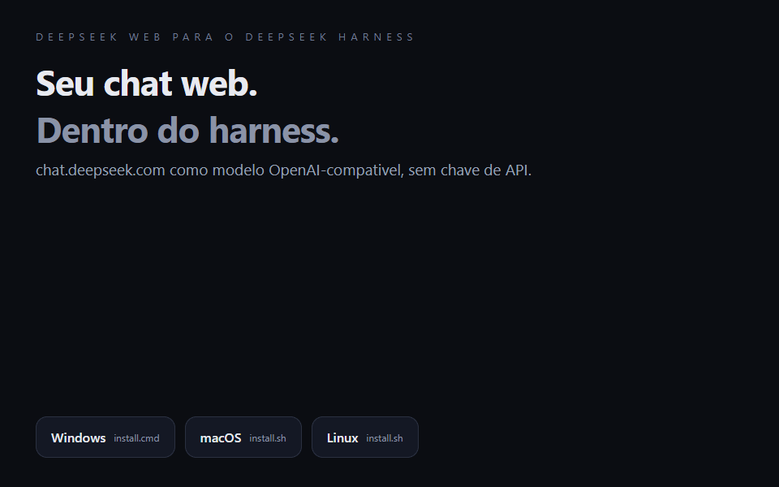

# DeepSeek Web Bridge

**Use o `chat.deepseek.com` como um modelo dentro do DeepSeek Harness (DSH) — sem chave de API.**

Uma ponte local (loopback) que conversa com a interface web do DeepSeek em um
Chrome dedicado e a expõe como um provider **compatível com a API da OpenAI**
(`/v1/models` + `/v1/chat/completions`, com streaming).

É a mesma ideia do [`codex-chatgpt-web`](https://github.com/miuuyy/codex-chatgpt-web),
adaptada para o **DeepSeek Harness**: em vez de fingir ser o app do Codex, a
ponte se registra como mais uma rota do plugin `@deepseek-ai/dsh-llm-pi-ai`.



> Demonstração ilustrativa montada com **saídas reais** medidas em execução
> (log da ponte, resposta `391` do chat web). O GIF é gerado por
> `scripts/make-demo.mjs`; não é gravação de tela.

[](https://github.com/LMPrado-DZ23/deepseek-web-bridge/releases/latest/download/deepseek-web-bridge.zip)
[](https://github.com/LMPrado-DZ23/deepseek-web-bridge/releases/latest/download/deepseek-web-bridge.tar.gz)
[](https://github.com/LMPrado-DZ23/deepseek-web-bridge/releases/latest/download/deepseek-web-bridge.tar.gz)
[](LICENSE)
[](https://nodejs.org/)

**[Instalação](#instalação)** · **[Como usar](#usar)** · **[Arquitetura](docs/architecture.md)** · **[Troubleshooting](TROUBLESHOOTING.md)** · **[Releases](https://github.com/LMPrado-DZ23/deepseek-web-bridge/releases)**

---

## Instalação

### Windows (PowerShell)

```powershell
irm https://raw.githubusercontent.com/LMPrado-DZ23/deepseek-web-bridge/main/install.ps1 | iex
```

Ou baixe o zip do [release mais recente](https://github.com/LMPrado-DZ23/deepseek-web-bridge/releases/latest),
extraia e rode `install.cmd`.

### macOS e Linux

```bash
curl -fsSL https://raw.githubusercontent.com/LMPrado-DZ23/deepseek-web-bridge/main/install.sh | bash
```

Ou baixe o `.tar.gz` do [release mais recente](https://github.com/LMPrado-DZ23/deepseek-web-bridge/releases/latest),
extraia e rode `bash install.sh`.

### Clonando o repositório

```bash
git clone https://github.com/LMPrado-DZ23/deepseek-web-bridge
cd deepseek-web-bridge
# Windows
powershell -ExecutionPolicy Bypass -File install.ps1
# macOS/Linux
bash install.sh
```

O instalador:

1. confere **Node.js 20+** e o **Google Chrome**;
2. baixa (quando necessário) e instala as dependências (`playwright-core`);
3. abre o **Chrome normal** para o login único no `chat.deepseek.com`
   (Google/Apple funcionam nessa janela);
4. registra o provider `deepseek-web` no perfil do DSH e grava a credencial de
   referência `DEEPSEEK_WEB_KEY` no cofre local.

Opções: Windows `-Profile`, `-Port`, `-NoLogin`, `-NoDsh`, `-DshHome`,
`-InstallDir`; macOS/Linux `PROFILE`, `PORT`, `NO_LOGIN=1`, `NO_DSH=1`,
`DSH_HOME`, `INSTALL_DIR`.

## Requisitos

| item | versão / observação |
| --- | --- |
| Node.js | 20 ou superior |
| Google Chrome | instalado (a ponte usa o Chrome real, `channel: 'chrome'`) |
| Conta | uma conta em `https://chat.deepseek.com` |
| DSH | qualquer perfil com o plugin `@deepseek-ai/dsh-llm-pi-ai` (padrão) |
| Sistema | Windows x64, macOS (Intel/Apple Silicon) ou Linux x64 |

## Deixe a ponte sempre no ar

O DSH **não inicia** a ponte por você. Se o processo não estiver rodando, o turno
falha com `Connection error` / `TRANSPORT` (o DSH ainda repete 5 vezes).

**Windows (recomendado):**

```powershell
powershell -ExecutionPolicy Bypass -File autostart.ps1
```

Cria um atalho em `Iniciar` que sobe a ponte **sem janela** em cada login. O
instalador também aceita `-AutoStart`. Para desfazer: `autostart.ps1 -Remove`.

**macOS/Linux (systemd de usuário):**

```ini
# ~/.config/systemd/user/deepseek-web-bridge.service
[Unit]
Description=Ponte DeepSeek Web
[Service]
WorkingDirectory=%h/.local/share/deepseek-web-bridge
ExecStart=/usr/bin/env node src/index.mjs serve
Restart=on-failure
[Install]
WantedBy=default.target
```

```bash
systemctl --user daemon-reload
systemctl --user enable --now deepseek-web-bridge
```

Conferir a qualquer momento: `curl -s http://127.0.0.1:8787/health`.

## Usar

1. Suba a ponte e **deixe a janela aberta**:

   ```powershell
   .\start.cmd        # Windows
   ./start.sh         # macOS/Linux
   ```

2. **Reinicie o DSH.** No seletor de modelos aparecem:
   - **DeepSeek Web (navegador)** — resposta rápida, tipo chat;
   - **DeepSeek Web Think (raciocínio no site)** — liga o "Pensamento Profundo".

> A ponte precisa estar no ar antes do primeiro turno. O DSH não inicia
> processos por você.

## Capacidades (o que o modelo consegue fazer)

O DSH executa as ferramentas; a ponte só precisa entregar a chamada certa. O que
já foi **medido de ponta a ponta** (DSH → ponte → chat web → DSH):

| capacidade | estado |
| --- | --- |
| conversa em texto e streaming | ✅ |
| raciocínio (`reasoning_content` separado do texto) | ✅ |
| executar shell (`pwsh`) e ler a saída | ✅ |
| ler, escrever e reler arquivos (tarefa de vários passos) | ✅ |
| **duas chamadas de ferramenta no mesmo turno** | ✅ (log `ferramentas=2`) |
| ferramentas MCP do DSH (filesystem, GitHub, browser…) | ✅ pelo mesmo mecanismo |
| subagentes, workflows, skills, `present`, `todo_write` | funcionam pelo mesmo caminho, mas **não validados ao vivo** aqui; cada subagente consome turnos web |
| tool-calling **nativo** (function calling da API) | ❌ é protocolo de texto, best-effort |
| imagens/anexos/visão | ❌ a ponte não envia anexos |
| garantias de exatamente-uma-execução / ordem | ❌ best-effort (se o site mudar, a chamada pode se perder) |

Os formatos aceitos de chamada são o bloco ```` ```tool_calls ```` e a sintaxe
**DSML** do site; o trecho da chamada nunca vaza como texto no streaming.

## Como funciona

```
DSH ──HTTP──▶ 127.0.0.1:8787 (esta ponte) ──Playwright──▶ Chrome dedicado
              /v1/models                                  chat.deepseek.com
              /v1/chat/completions                        (sessão persistida)
```

- A conversa é achatada em um prompt único e enviada em um **chat novo** no site.
- A resposta é lida do **corpo SSE** de `/api/v0/chat/completion` (autoritativo),
  com fallback no DOM.
- Fragmentos `THINK` viram `reasoning_content`; fragmentos `RESPONSE` viram
  `content`. **Os dois nunca se misturam.**
- A cada turno os botões medidos são ajustados: "Pensamento Profundo" conforme o
  modelo e **"Pesquisa inteligente" sempre desligada** (vinha ligada por padrão e
  adiciona latência).
- Um turno por vez (fila serial), o que evita duas abas se atropelando.
- Cada turno é registrado no log: modelo, tamanho do prompt/resposta, raciocínio,
  ferramentas, origem do texto e tempo.
- **Chamadas de ferramenta:** a ponte entende o bloco ```` ```tool_calls ```` e
  também a sintaxe interna **DSML** que o site às vezes imita
  (`<|DSML|invoke name="…">`), inclusive quando o markdown deforma os pipes
  (`<| | DSML | | invoke…`). O trecho da chamada não vaza mais como texto no
  streaming: vira `tool_calls` de verdade.

## Integração com o DSH

O instalador faz isso; se quiser conferir ou fazer à mão:

```yaml
# ~/.dsh/profiles/desktop/cordis.patch.yml
- id: llm-pi-ai
  name: '@deepseek-ai/dsh-llm-pi-ai'
  config:
    providers:
      deepseek-web:
        displayName: DeepSeek Web (navegador)
        api: openai-completions
        apiKeyEnv: DEEPSEEK_WEB_KEY
        baseURL: http://127.0.0.1:8787/v1
        defaultContextWindow: 131072
        defaultMaxTokens: 8192
        models:
          - id: deepseek-web
            name: DeepSeek Web (chat no site)
            contextWindow: 131072
            maxTokens: 8192
          - id: deepseek-web-think
            name: DeepSeek Web Think (raciocinio no site)
            contextWindow: 131072
            maxTokens: 32768
        compat:
          supportsDeveloperRole: false
          supportsUsageInStreaming: false
```

A credencial é só um marcador (a ponte ignora o header `Authorization`) e mora
no cofre do harness, **não** no `.env`:

```yaml
# ~/.dsh/.credentials.yaml
version: 1

refs:
  DEEPSEEK_WEB_KEY: ponte-local-sem-chave

records: {}
```

O app desktop **não** lê `%DSH_HOME%\.env` para `apiKeyEnv`; se o valor estiver
só lá, o turno falha com `MISSING_CREDENTIAL`.

Arquivo pronto para colar: [`examples/dsh-deepseek-web.patch.yml`](examples/dsh-deepseek-web.patch.yml).
Configurador manual: `node scripts/configure-dsh.mjs --profile desktop`.

## Endpoints

| rota | descrição |
| --- | --- |
| `GET /health` | estado da ponte (`?deep=1` confere o login no site) |
| `GET /v1/models` | catálogo compatível com OpenAI |
| `POST /v1/chat/completions` | chat, com `stream: true` ou `false` |

```bash
curl -s http://127.0.0.1:8787/v1/chat/completions \
  -H 'content-type: application/json' \
  -d '{"model":"deepseek-web","messages":[{"role":"user","content":"Responda apenas: ok"}]}'
```

## Comandos

| comando | para que serve |
| --- | --- |
| `install.cmd` / `install.ps1` | instalação completa no Windows |
| `install.sh` | instalação completa no macOS/Linux |
| `start.cmd` / `./start.sh` | sobe o servidor local (`--port`, `--headed`, `--log-level debug`) |
| `login.cmd` / `./login.sh` | login único no Chrome normal; `--auto` usa o Chrome automatizado |
| `verify --wait` | espera a janela de login fechar e confere a sessão |
| `diagnose --headed` | mede a página e mostra seletores OK/faltando |
| `probe "texto" --mode think` | testa um turno direto no site, sem DSH |
| `models` | lista modelos e o total de seletores DOM |
| `npm test` | testes de unidade (parser do SSE, fila, prompt, servidor, instalador) |
| `npm run demo` | regenera `assets/demo.gif` |

## Limitações reais

- **Sem tool-calling nativo.** A ponte injeta o catálogo de ferramentas no prompt
  e interpreta o bloco ```` ```tool_calls ```` **ou a sintaxe DSML** que o site
  imita — funciona para MCP simples, mas não tem a confiabilidade da API oficial.
  Para uso agente sério, prefira as rotas oficiais `deepseek-account` /
  `deepseek-api-key` do DSH.
- Latência de segundos a dezenas de segundos por turno (é um navegador).
- Depende do DOM do site: se o DeepSeek mudar o layout, rode `diagnose` e ajuste
  `src/selectors.json`.
- A sessão expira de vez em quando: rode o login de novo.
- Pode haver desafio anti-bot (PoW/WAF); nesse caso a resposta vem como
  `CHALLENGE`.
- O caminho de login nativo usa PowerShell no Windows, `ps` no macOS/Linux; é o
  único trecho que muda por sistema.

## Aviso de uso

Automatizar o `chat.deepseek.com` com a sua própria sessão **pode contrariar os
Termos de Uso** do serviço e existe risco de restrição da conta. Use por sua
conta e risco. Para uso profissional, a rota oficial autenticada do DSH é a
indicada.

## Segurança

- Escuta apenas em `127.0.0.1` (loopback).
- Sem token por padrão; defina `DSB_TOKEN` para exigir
  `Authorization: Bearer <token>`.
- O perfil do Chrome guarda os cookies da sua conta fora do repositório
  (`%LOCALAPPDATA%` no Windows, `~/Library/Application Support` no macOS,
  `~/.local/share` no Linux) — não copie essa pasta.
- A ponte não lê nenhuma credencial do DSH; `DEEPSEEK_WEB_KEY` é um marcador.

Detalhes em [`SECURITY.md`](SECURITY.md).

## Problemas comuns

- `MISSING_CREDENTIAL` → falta a referência no cofre ou o provider está sem
  `apiKeyEnv`.
- `Target page, context or browser has been closed` / Chrome `exit 21` → outro
  Chrome está usando o perfil da ponte; feche-o.
- `COMPOSER_NOT_FOUND` / `site_layout_changed` → o layout mudou: rode
  `node src/index.mjs diagnose --headed` e atualize `src/selectors.json`.
- Login do Google recusado → use o login nativo (Chrome normal), **nunca** o modo
  `--auto` para SSO.

Mais em [`TROUBLESHOOTING.md`](TROUBLESHOOTING.md).

## Estrutura

```
src/        servidor HTTP, transporte Playwright, parser do SSE, prompt, config
test/       testes de unidade (node --test)
scripts/    instalador do DSH, smoke do servidor, diagnóstico, gerador do GIF
examples/   trecho de perfil do DSH
docs/       arquitetura
assets/     demo.gif
install.ps1 / install.cmd / start.cmd / login.cmd   (Windows)
install.sh  / start.sh     / login.sh               (macOS/Linux)
```

## Desenvolvimento

```bash
npm install
npm test                        # 52 testes
node scripts/smoke-server.mjs   # sobe a ponte, faz um turno real e derruba
npm run demo                    # regenera assets/demo.gif
```

Requisitos: Node 20+, Chrome instalado, sessão válida no `chat.deepseek.com`.
As capturas reais de SSE usadas como oráculo estão em `data/sse-*.txt`
(não versionadas por conterem conversa; veja `data/README.md`).

CI roda `node --test` em Windows, macOS e Linux (Node 20 e 22) e valida o
`install.ps1` — veja [`.github/workflows/ci.yml`](.github/workflows/ci.yml).

## Diferenças em relação ao `codex-chatgpt-web`

| | codex-chatgpt-web | este projeto |
| --- | --- | --- |
| alvo | ChatGPT web no Codex | DeepSeek web no DeepSeek Harness |
| transporte | proxy Responses API + daemon Electron | servidor HTTP + Playwright (`playwright-core`) |
| integração | catálogo do Codex / MCP | provider OpenAI-compatible do DSH |
| token de API | não usa | não usa (marcador local) |
| tool-calling | protocolo próprio | protocolo de texto (mesma ideia, mais simples) |
| sistemas | Windows, macOS, Linux | Windows, macOS, Linux |

## Licença

MIT — veja [`LICENSE`](LICENSE).
